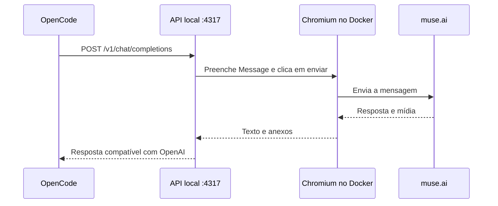

# Muse Web → OpenCode: arquitetura e operação

> Projeto comunitário e não oficial. A ponte automatiza a interface web do Muse.ai e a conecta ao OpenCode por uma API local. A Meta não mantém nem aprova este projeto. Ele usa a conta pessoal do site, não a Meta Model API; saldo, limites e regras continuam vinculados à conta. Mudanças no site podem interromper a automação. Confira os termos vigentes e não use o projeto para contornar controles, limites ou restrições.

## Objetivo

Este projeto expõe a conversa web do Muse como uma API local compatível com OpenAI Chat Completions. O OpenCode envia mensagens à API; o serviço controla a mesma aba do Chromium em que a pessoa fez login, aguarda a resposta do Muse e devolve texto e anexos.

O navegador roda dentro do Docker. Não é necessário iniciar nem deixar aberto um navegador do Windows.

## Fluxo de uma mensagem



O serviço usa uma aba e processa uma solicitação por vez para manter a conversa sincronizada. Ele espera até três minutos pela resposta. Se receber novamente o mesmo pedido, devolve a resposta já obtida em vez de enviar a mensagem outra vez. Nos pedidos de agente, as instruções `system`/`developer` do OpenCode são preservadas no contexto enviado ao Muse, junto ao protocolo das ferramentas. Os resultados seguintes são enviados como novos turnos na mesma conversa.

Saudações simples, como "Boa noite, Muse.", são encaminhadas literalmente, sem instruções ou definições de ferramentas. Pedidos com ferramentas usam um protocolo JSON: o Muse descreve a próxima operação e o OpenCode a executa no WSL, com as permissões configuradas no cliente. Os arquivos locais não precisam ser montados no container.

Cada sessão do OpenCode corresponde a uma conversa do Muse. O cabeçalho nativo `X-OpenCode-Session-Id` identifica a sessão; clientes diretos devem enviar `X-Muse-Session-Id` estável por conversa. A primeira chamada abre `/thread/new` e registra a URL atribuída pelo Muse. Chamadas seguintes, resultados de ferramentas e alterações do histórico continuam na mesma conversa. Ao alternar A → B → A, a ponte navega para a URL já registrada de A. O arquivo `/data/conversations.json` preserva os vínculos, histórico sincronizado, resposta e envio pendente no volume, com permissão 0600. A aba processa uma chamada por vez.

A leitura da resposta usa os identificadores `data-message-id` e `data-message-role` e considera apenas as mensagens do assistente posteriores ao novo balão do usuário. Ela aguarda o estado de geração terminar. Mudanças na renderização do texto, atualizações de mensagens antigas e reações não são usadas para reconhecer uma resposta nova.

Se o cliente desconectar, a ponte interrompe a espera e libera a fila. O envio pendente fica associado ao hash da solicitação; repetir a mesma chamada retoma a leitura dos mesmos IDs sem clicar em enviar novamente. A mesma resposta concluída também é reutilizada. Um pedido diferente na mesma sessão recebe 409 enquanto houver um envio sem confirmação; outras sessões usam suas próprias conversas. O aviso nativo “Delivery not confirmed” também retorna 409, sem reenviar automaticamente.

Erros após uma tentativa de envio e o limite de espera retornam HTTP 409 para evitar repetições automáticas de um envio incerto. A recuperação é mantida na memória de um único processo e não sobrevive a reinicializações. O endpoint de estado informa a chamada ativa e o tempo do envio pendente; os logs registram hash abreviado, fase, duração e conclusão, sem registrar o conteúdo ou as credenciais.

O pedido auxiliar do OpenCode para gerar um título é atendido localmente, usando até 50 caracteres da mensagem. Ele não gera outro envio ao Muse nem altera a conversa ativa.

## Componentes e portas

| Componente | Função |
| --- | --- |
| API Node.js | Painel local, chave de acesso e endpoints compatíveis com OpenAI. |
| Chromium no Docker | Navegador persistente usado tanto para o login quanto para enviar e ler mensagens. |
| noVNC | Mostra e controla o Chromium pelo navegador do computador. |
| Volume Docker `muse-opencode-bridge-data` | Guarda o perfil do Chromium e a chave local da API. |

As portas publicadas são `127.0.0.1:4317` (painel e API) e `127.0.0.1:4318` (tela noVNC). O Compose limita as duas ao computador local.

## Iniciar e autenticar

No terminal WSL, dentro desta pasta:

```bash
docker volume create muse-opencode-bridge-data
docker compose up --build -d
```

Abra `http://127.0.0.1:4317`. O painel mostra a aba que a API usará. Para autenticar, clique em **Abrir Chromium** ou acesse `http://127.0.0.1:4318/vnc.html?autoconnect=1&resize=scale&path=websockify`. Faça login no Muse e clique em **Confirmar login**. O estado esperado é **Muse autenticado no Chromium do Docker**.

Depois do login, pode fechar a aba do noVNC. O Chromium continua dentro do container; mantenha o Docker em execução para usar a API. Cookies e outros dados de autenticação ficam no perfil persistente do Chromium no volume. Ao reiniciar o serviço, ele abre esse mesmo perfil até o Muse expirar ou revogar a sessão.

## Conectar o OpenCode

No painel, copie a configuração exibida para o `opencode.json` global ou do projeto. Ela registra o provedor `muse`, a base URL `http://127.0.0.1:4317/v1` e o modelo `muse-web`. Em seguida, selecione `muse/muse-web` no OpenCode.

A chave local é criada na primeira inicialização e guardada no volume, em `/data/api-key`. O painel a inclui na configuração para copiar. Ela dá acesso à ponte local; não é a senha do Muse.

## Endpoints

- `GET /` abre o painel e mostra o estado do navegador.
- `GET /v1/models` lista o modelo `muse-web`.
- `POST /v1/chat/completions` recebe mensagens no formato Chat Completions e retorna a resposta do Muse.
- `POST /v1/chat/completions` também aceita `stream: true`; os eventos SSE são enviados depois que o Muse termina de responder, pois a página não fornece tokens intermediários à ponte.

As rotas `/v1` exigem `Authorization: Bearer <chave local>`. O painel usa um token de controle próprio, gerado em cada inicialização; ele não é a chave da API.

Exemplo de chamada direta:

```bash
curl http://127.0.0.1:4317/v1/chat/completions \
  -H 'Authorization: Bearer SUA_CHAVE_LOCAL' \
  -H 'Content-Type: application/json' \
  -H 'X-Muse-Session-Id: minha-conversa' \
  -d '{"model":"muse-web","messages":[{"role":"user","content":"Boa noite, Muse."}]}'
```

O conteúdo pode incluir texto e imagens em data URL ou áudio em Base64/data URL. Cada anexo pode ter até 12 MB e o total por mensagem até 24 MB. Se o Muse produzir imagem, áudio ou vídeo acessível na mesma origem do site, a resposta pode incluir esses dados em `choices[0].message.attachments`. Essa lista de anexos é uma extensão da resposta OpenAI e a interface cliente precisa saber exibi-la.

O adaptador converte uma resposta JSON do Muse com type tool_call, name e arguments em tool_calls no formato OpenAI. O OpenCode executa a ferramenta local e envia o resultado de volta; o Muse pode pedir outra operação ou produzir uma resposta com type final e text. O marcador legado opencode_tool_call também é aceito.

Para `write` e `edit`, o conteúdo do arquivo viaja em um bloco bruto delimitado, protegido por quatro crases. Isso evita que o renderizador do Muse interprete tags HTML/JSX e as remova, além de não exigir que o modelo escape aspas em um JSON longo. Se uma chamada de ferramenta chegar incompleta, a ponte pede uma única tentativa corrigida; se ainda falhar, devolve um erro explícito e não apresenta a operação como concluída.

Para trabalhar com arquivos, use o agente Build do OpenCode e permita as ferramentas necessárias. A ponte não executa shell nem edita arquivos do WSL por conta própria. Ela transmite operações ao cliente; consultar o terminal interno do Muse retornaria arquivos e diretórios da VM do Muse, não do WSL. Operações de agente precisam desse protocolo adicional na conversa web; enviar somente a frase do usuário é suficiente para conversas simples.

## Dados e privacidade local

O volume `muse-opencode-bridge-data` mantém `/data/chromium-profile` (perfil autenticado do navegador), `/data/api-key` (chave local da ponte) e os vínculos das conversas. Mensagens e anexos enviados ao backend são encaminhados ao Muse. Não compartilhe o volume, a chave, cookies, arquivos de sessão ou a configuração copiada do painel. Senha e código de autenticação são digitados no Muse e não fazem parte dos pedidos enviados pelo OpenCode.

## Comandos de operação

```bash
docker compose ps                 # estado e portas
docker compose logs -f            # acompanhar o serviço
docker compose restart            # reiniciar sem apagar os dados
docker compose down               # parar e remover o container; preserva o volume
docker compose up -d              # iniciar novamente
```

Para reconstruir a imagem depois de alterar o código:

```bash
docker compose up --build -d
```

`docker compose down -v` ou remover o volume manualmente apaga o perfil, a chave e a sessão persistida. Para revogar o acesso, saia da conta do Muse ou remova a sessão nas configurações da conta; para recriar somente a chave da ponte, pare o serviço e remova `/data/api-key` do volume antes de iniciar novamente.

## Diagnóstico rápido

| Sintoma | Verificação |
| --- | --- |
| Painel não abre | Confirme `docker compose ps` e abra `http://127.0.0.1:4317`. |
| noVNC não conecta | Abra `http://127.0.0.1:4318/vnc.html?autoconnect=1&resize=scale&path=websockify` e confira os logs do container. |
| Painel pede login | Abra o Chromium no noVNC, conclua a autenticação e espere **Muse autenticado no Chromium do Docker**. |
| OpenCode retorna 401 | Confira se a chave copiada do painel está no provedor `muse` e se o painel detecta a sessão autenticada. |
| Muse mostra “Something went wrong” | Confira a mesma aba do Chromium mostrada no painel. Se o erro estiver nela, recarregue a página no Chromium e confirme a sessão antes de repetir a chamada. |
| Não localiza a caixa ou o botão de envio | A interface do Muse pode ter mudado; ajuste `MUSE_COMPOSER_SELECTOR`, `MUSE_SEND_SELECTOR`, `MUSE_RESPONSE_SELECTOR` ou `MUSE_ATTACH_SELECTOR`. |
| A resposta demora ou expira | Confira no painel se a conversa terminou; o limite de espera atual é três minutos. |
| Muse responde com /home/hatch ou diz não acessar o WSL | Verifique se o OpenCode enviou ferramentas e se a imagem Docker está atualizada. Esse caminho pertence à VM do Muse; uma execução local deve aparecer no OpenCode como chamada de ferramenta. |

A cota e as regras de uso continuam sendo as da conta e da interface web do Muse; esta ponte não cria uma API oficial do Muse.

## Resiliência e peso da conversa (2026-10)

Melhorias feitas a partir de falhas reais de uso longo com o OpenCode. Todas estão em `src/server.js` e `src/protocol.js`, com testes das funções puras em `src/protocol.test.js`.

| Problema observado | O que a ponte faz agora | Evento no log |
|---|---|---|
| O Muse mostra "Delivery not confirmed" e a sessão ficava presa em `submission_pending` | Solta o envio pendente e reenvia sozinha até 2 vezes, com 3 s e 6 s de espera. O site informou que a mensagem não chegou, então não duplica. Outros alertas (limite de uso, muitas requisições) continuam preservados | `delivery_retry`, `released_undelivered` |
| Chegava uma mensagem nova numa sessão com envio antigo não entregue | Confere a conversa no Muse e libera o pendente se o site o marcou como não entregue | `released_undelivered` |
| A aba do Muse chegava a 1,7 milhão de caracteres e 3 GB de memória, deixando a página lenta (ponto laranja, falhas de entrega) | Nas mensagens seguintes envia só as mensagens novas e uma linha curta; o catálogo completo de ferramentas volta a cada 6 envios ou quando ele muda | `waiting.promptChars` |
| Mesmo assim a conversa cresce | Abre outra thread no Muse depois de 300 mil caracteres de crescimento ou 40 turnos (`MUSE_ROTATE_CHARS`, `MUSE_ROTATE_TURNS`). O primeiro envio, grande por natureza, não conta. A thread nova recebe as instruções do sistema e as mensagens mais recentes que cabem no limite | `thread_rotated` |
| Reiniciar a ponte derrubava o envio em andamento | O corpo da chamada é guardado junto do envio pendente. Ao subir, se o envio já foi entregue e tem menos de 30 minutos, a ponte repete a mesma chamada só para retomar a leitura e deixa a resposta no cache para o retry do OpenCode | `resumed_after_restart` |
| O Muse mostrava a resposta, mas não a marcava como concluída, e a ponte esperava para sempre | Aceita a resposta quando o texto para de mudar por 60 s (`MUSE_STALL_MS`) | n/d |
| A thread quebrava ("Something went wrong", "Conversation controls unavailable") e a caixa de mensagem sumia | Clica no **Try again** do site; se persistir, sai da página quebrada, abandona a thread e pede nova tentativa com o prompt completo numa thread nova | `site_try_again`, `left_broken_page`, `thread_abandoned` |
| O Muse reescrevia de memória o `oldString` do `edit` e o OpenCode recusava | As instruções, completas e curtas, mandam copiar o `oldString` exatamente do último `read` e reler o arquivo quando o `edit` falha | n/d |

Limites que continuam valendo: reenvios automáticos são no máximo 2 por chamada; a retomada após reinício não mexe em envios com mais de 30 minutos nem em envios cuja entrega ao Muse não foi confirmada; uma recusa de entrega deixa uma mensagem duplicada no histórico da thread do Muse, sem afetar as respostas.

Para ajustar sem alterar código, defina as variáveis no `.env` e recrie a ponte numa pausa: `MUSE_ROTATE_CHARS`, `MUSE_ROTATE_TURNS`, `MUSE_STALL_MS`.
